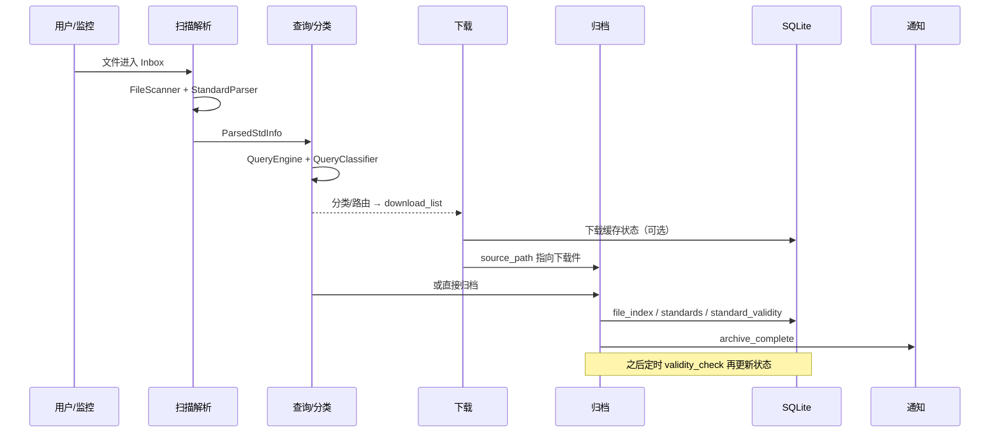

# 02 · 一条文件的旅程

> 这是整套 onboarding 的核心。  
> 目标：给你一个文件，你能从 Inbox 一路讲到归档，并说出每一步的代码入口和数据库表。

---

## 一、主角

```text
/inbox/GB 国家标准/GB/T 1234-2020 某某技术规范.pdf
```

我们用这一个文件贯穿全篇。

---

## 二、七站总览



---

## 第 1 站：发现（文件怎么进来）

### 可能入口

| 入口 | 代码 | 行为 |
|---|---|---|
| Web 手动扫描 | `POST /api/scan` → `docker/api/scan.py` | 扫描指定目录，返回文件列表 |
| Win 手动扫描 | `ScanWorker` → `mgr.scan_directory()` | 扫描后进入表格 |
| CLI | `python main.py --cli scan <dir>` | 扫描并输出 |
| Docker 监控 | `pilotstd/monitor/scheduler.py::_on_file` | 发现新文件后扫描+归档 |
| Win 可选 watcher | `pilotstd/scan/watcher.py::FileWatcher` | **只更新 `file_index`，不归档** |

### 关键认知

**“发现”不等于“归档”。** 不同入口发现后的动作不同，这是后面很多差异的根源。

---

## 第 2 站：扫描与解析

### 做什么

1. `FileScanner.scan([root])` 遍历目录：
   - 按 `scan.extensions` 过滤（默认 `.pdf/.doc/.docx/.txt`）；
   - 跳过 `scan.skip_folders`（含“过期作废”）；
   - 按 `scan.exclude_patterns` 跳过关键词；
   - 计算内容哈希，做**本批次内存去重**；
   - 生成 `FileInfo`。
2. `ScanHandler.scan_directory()` 对每个文件调用 `StandardParser.parse(filename)`：
   - 解析 `logical_code / number / year / part / std_name / ext`；
   - 按 `(code, number, year, part)` 去重；
   - 写入内存 `parsed_results`；
   - 发 `scan_complete` 通知。

### 代码入口

| 步骤 | 文件/函数 |
|---|---|
| 遍历 | `pilotstd/scan/scanner.py::FileScanner.scan` |
| 解析 | `pilotstd/scan/parser/__init__.py::StandardParser.parse` |
| 目录扫描封装 | `pilotstd/manager/facade/_scan.py::ScanHandler.scan_directory` |

### 数据流

| 项 | 内容 |
|---|---|
| 输入 | 目录路径 |
| 输出 | `list[ParsedStdInfo]`（内存） |
| 读表 | 当前装配未给 `FileScanner` 注入 `file_index`，跨扫描哈希去重不生效；只做本批内存去重 |
| 写表 | 不写 `file_index`；`scan_complete` 写 `notification_log` |

### 失败分支

- 文件名解析不出标准号：`解析失败: path=... error=no_match`；
- 文件被占用/消失：`stat失败`；
- 内容重复：本批次内存去重或 `file_index` 哈希去重（若启用）。

**常见误解**：`scan_directory` 只解析，不搬文件、不写 `file_index`。真正写入在归档。

---

## 第 3 站：查询与有效性判断

### 做什么

1. `QueryHandler.query(parsed)` → `QuerySubsystem.query()`；
2. `QueryEngine.query_standards()`：
   - 默认走实时适配器；
   - 配置 `query.use_announcement_match=true` 时先走公告缓存；
   - 查 `standard_info_cache`，不命中回退 `announcement_match`；
   - 结果写回 `standard_info_cache`。
3. `QueryClassifier.classify()`：
   - `_write_back_results()` 把 `QueryResult.status` 写回 `p.effect_status`；
   - 写 `match_status / found_replaces / is_adopted / found_name / found_*`；
   - `resolve_replaces()` 对废止且无替代的 GB 标准跨站补查；
   - `PipelineRouter.apply_actions()` 分堆。

### 分堆结果

| 桶 | 去向 |
|---|---|
| `archive` | 直接归档 |
| `normalize` | 文件名不规范，预期规范化后归档 |
| `download` | 缺失/新版/被替代的 GB 类 |
| `manual_download` | 非 GB 缺失，需人工 |
| `pending` | 待确认 |
| `fallback` | 兜底镜像 |

### 数据流

| 项 | 内容 |
|---|---|
| 输入 | `parsed_results` |
| 输出 | `query_results`；`download_list`/`pending_list`/`expire_list`；`ParsedStdInfo` 上补 `effect_status` |
| 读表 | `standard_info_cache`、`announcement_match`、`announcement_record` |
| 写表 | `standard_info_cache`、`daily_quota`、`adapter_state`、`query_metrics`、`announcement_record.final_name`、`pending_lookup`、`notification_log` |

### 关键认知

- **查询是“现在”**：`effect_status` 来自本次查询；
- **`standard_validity` 是“历史/待复检”**：这一步不读它；
- 查询失败/未知 → `pending`，不一定归档。

---

## 第 4 站：下载（只有需要的才下）

### 触发条件

由 `PipelineRouter` 决定，常见：

- `match_status == "newer"` 且是 GB、未采标、本地没有新版 → 下载；
- 状态废止/被代替，且有合法 GB 替代标准 → 下载替代；
- 状态现行但本地无文件且是 GB → 下载；
- 非 GB 缺失 → `manual_download`；
- 未知/待确认 → `pending`；
- 其他 → `fallback`。

### 做什么

1. `DownloadHandler.download()` 从 `download_list` + `query_results` 构造 `DownloadTask`；
2. `DownloadEngine.download_batch()`：
   - 按 `download.batch_size` 分批；
   - 线程池并发；
   - 网络失败重试；
   - `_save_file()` 落盘（`.part` → `os.replace`）。
3. 落盘位置：
   - `save_root = get_library_root(cfg)`；
   - Docker 下是 `/standards`；
   - 只生成规范文件名，**不生成分类子目录**。
4. `_post_process_download()`：
   - 把 `task.saved_path` 回写到对应 `ParsedStdInfo.source_path`；
   - 对“被代替/新版”更新 `standard_info_cache` 状态。

### 数据流

| 项 | 内容 |
|---|---|
| 输入 | `download_list` + `query_results` |
| 输出 | `DownloadTask`、`task.saved_path`、更新后的 `source_path` |
| 读表 | `standard_info_cache` |
| 写表 | `standard_info_cache`（状态回写）、`notification_log`（`batch_download_complete`） |

### 重要差异

- `auto_run` / Win 一键：下载后同批继续归档；
- 生产当前 Web `/api/download`：只下载、不回灌归档；本地代码已修，待部署；
- Win 手动分步：下载后需用户点归档；
- 收藏链：下载到 Inbox 后由 `_archive_inbox_file()` 自己归档。

---

## 第 5 站：归档（真正落盘）

### 做什么

`archive_standards(parsed_list)` → `OrganizerCore.organize()`：

1. 按 `(logical_code, number, year)` 去重；
2. `next_action=="pending"` 跳过；
3. Word/模板 vs 非 Word 分流：
   - **Word/模板**：`_organize_word_item()` 重新解析文件名 → `FileMover.normalize_filename()` → `safe_move` → `file_index.upsert`；
   - **非 Word**：`hash_file_content()` 内容去重 → `FileMover.move_to_code_dir()` → `safe_move` → `_dedup_standard()` → `file_index.upsert` → `_register_standard()`。
4. `archive_standards()` 后处理：
   - `register_new_standard()` 写 `standard_validity`（初始“未知”）；
   - 废止标准发 `expire_standard_moved`；
   - 发 `archive_complete`。

### 目标路径怎么算

- 目录：`get_folder_name(logical_code)`（`pilotstd/organizer/industry_lookup.py`）
- 文件名：`make_standard_filename(...)`（`pilotstd/core/file_utils.py`）
- 废止：`FileMover.normalize_filename()` 在目录后追加 `过期作废`

### 数据流

| 项 | 内容 |
|---|---|
| 输入 | `ParsedStdInfo` + `source_path` |
| 输出 | 文件落盘；`result.moved/failed/skipped_exists/details` |
| 读表 | `file_index`（按标准号查旧路径）、`standard_info_cache`（回填名称） |
| 写表 | `file_index`、`standards`、`standard_validity`、`notification_log` |

### 关键认知

- **归档才写 `file_index`**；
- **归档不读 `standard_validity`**，只写“未知”；
- Word 重解析使用 `OrganizerCore._std_parser`，它的 scan.code_mapping 默认空，见 [`08-known-boundaries.md`](08-known-boundaries.md)。

---

## 第 6 站：收容与清理

### 做什么

`auto_run` 在归档后：

1. `organize_skipped_dirs()`：把扫描时跳过的目录整体/逐文件镜像到库；
2. `organize_fallback()`：把源目录剩余文件按相对路径镜像；
3. 跳过 `Thumbs.db`、`sync.ffs_db`、`~$`。

### 数据流

| 项 | 内容 |
|---|---|
| 输入 | `skipped_dirs` / 源目录残留 |
| 输出 | 文件镜像到库 |
| 读表 | 无 |
| 写表 | 无（这条路径不写 `file_index`/`standard_validity`） |

### 关键认知

监控 `_on_file` 在 2026-11-10 前**不调用**这两步；当时无标准号文件/跳过目录会留在 Inbox。  
**2026-11-10 复测更新**：`_on_file` 已改为调用 `auto_run`，因此 `organize_fallback`（无标准号兜底）和 `query` 回写 `effect_status` 都走主链；旧描述只适用于历史版本。若 `storage.mirror_fallback=false`，才仍留在 Inbox。

---

## 第 7 站：通知与后续时效检查

### 归档通知

- `archive_standards()` 发 `archive_complete`；
- `auto_run` 最后发 `auto_pipeline_summary`；
- Docker monitor 每个文件事件可能各发一条（取决于当前实现）。

### 事后时效检查（不是文件入口链）

- 定时：`docker/scheduler.py` 注册 `validity_check`（线上每周三 03:00 UTC，具体以配置为准）；
- 手动：`POST /api/validity/run`；
- 流程：`run_validity_check()` → 采样到期标准 → L1/L2/L3 → `update_status()`；
- 只有 `evidence=="L2"` 且 `validity.auto_move_expired=true` 才 `_move_expired_file()` 搬“过期作废”。

### 数据流

| 项 | 内容 |
|---|---|
| 输入 | `standard_validity` 到期行 |
| 输出 | 状态更新；可能移动文件 |
| 读表 | `standard_validity`、`announcement_match`、`announcement_record`、`file_index` |
| 写表 | `standard_validity`、`file_index`、`notification_log`；可能 `download_queue` |

---

## 三、一张总表：每站代码与表

| 站 | 核心函数 | 读表 | 写表 | 典型日志 |
|---|---|---|---|---|
| 发现 | `_on_file` / `scan` API / `ScanWorker` | 配置 | `notification_log` | `[MONITOR] 检测到新文件` |
| 扫描解析 | `FileScanner.scan`、`StandardParser.parse` | 配置 | `notification_log`（scan_complete） | `扫描完成: X/Y 识别成功` |
| 查询分类 | `QueryEngine.query_standards`、`QueryClassifier.classify` | `standard_info_cache`、`announcement_match` | `standard_info_cache`、`daily_quota`、`query_metrics`、`pending_lookup` | `查询完成: X/Y 找到` |
| 下载 | `DownloadEngine.download_batch`、`_save_file` | `standard_info_cache` | `standard_info_cache`、`notification_log` | `保存成功` / `跳过已存在` |
| 归档 | `OrganizerCore.organize`、`FileMover` | `file_index`、`standard_info_cache` | `file_index`、`standards`、`standard_validity` | `移动成功` / `归类完成` |
| 收容 | `organize_skipped_dirs`、`organize_fallback` | 无 | 无 | `兜底镜像完成` |
| 时效检查 | `run_validity_check`、`update_status` | `standard_validity`、`announcement_*`、`file_index` | `standard_validity`、`file_index` | `时效性检查完成` |
| 通知 | `NotificationManager.send_event` | 策略/渠道 | `notification_log` | `通知 ...` |

---

## 四、三个异常分支（必须会讲）

### 1. 解析失败

```text
解析失败: path=特种设备无损检测机构鉴定评审指南.pdf type=.pdf error=no_match detail=8_matchers
```

- 原因：文件名没有标准号；
- 结果：不进 `parsed_results`，留在 Inbox；
- 处理：兜底镜像或人工命名。

### 2. 目标已存在

- `FileMover.normalize_filename()` 目标存在；
- `result.skipped_exists += 1`；
- 若 `organize.auto_clean_source=true`，尝试删除源文件；
- 删除失败只记 debug，源文件会留在 Inbox。

### 3. 废止/过期

- Query 得到废止/被代替/作废/过期；
- `effect_status` 进入废止集合；
- `FileMover.normalize_filename()` 追加 `过期作废`；
- 若没有 `effect_status`，不会进“过期作废”。

---

## 五、四个入口的同一段旅程

| 站 | Web TaskView | Win 一键 | CLI `auto` | Docker Monitor |
|---|---|---|---|---|
| 扫描 | ✅ | ✅ | ✅ | ✅ |
| 查询 | ✅ | ✅ | ✅ | ❌ |
| 下载 | ✅（生产当前不回灌；本地已修待部署） | ✅ | ✅ | ❌ |
| 归档 | ✅（只归档扫描件） | ✅ | ✅ | ✅ |
| 收容/清理 | ❌ | ✅ | ✅ | ❌ |
| 汇总通知 | 分段 | `auto_pipeline_summary` | `auto_pipeline_summary` | 每文件/每归档 |

---

## 六、自检

1. 文件在扫描阶段被搬走了吗？写 `file_index` 了吗？
2. `effect_status` 从哪来？归档读 `standard_validity` 吗？
3. 下载件落在哪个目录？为什么不是分类目录？
4. 归档的目标路径由哪两个函数决定？
5. 无标准号文件最后去哪？
6. 废止标准一定会进“过期作废”吗？
7. Web 和 Win 的“一键”差在哪？

参考答案见 [`10-assessment.md`](10-assessment.md)。
