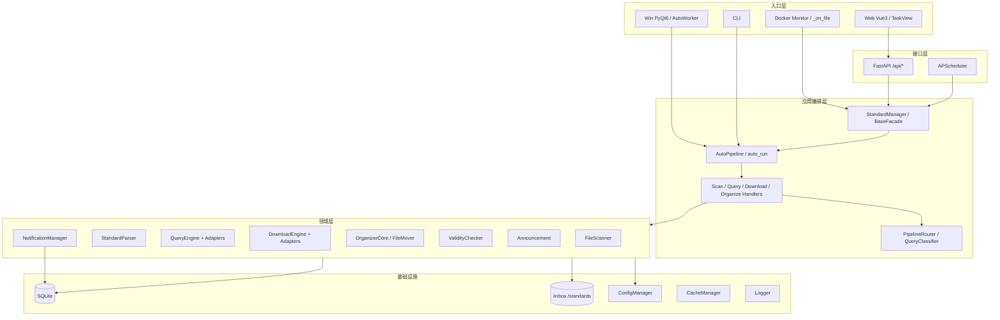

# 03 · 三端一引擎：整体架构

> 本文件回答：系统由哪些层组成、每层负责什么、改功能应该改哪里。  
> 核心认知：**业务引擎只有一套，入口/编排有多套。**

---

## 一、总原则

1. **一个引擎**：`pilotstd/manager/` 下的 `StandardManager` 是三端共享的业务门面。
2. **多个入口**：Web、Win、CLI、Docker monitor 各自负责“怎么触发/怎么展示”。
3. **核心链路统一**：扫描、解析、查询、路由、下载、归档、有效性都在 `pilotstd/` 内，不按端复制。
4. **端差异在编排层**：Web 五段式、Win `auto_run_stream`、Docker `_on_file` 是不同编排，不是三套业务实现。
5. **数据/文件系统是共享事实**：SQLite + `/inbox` + `/standards` 是最终状态。

---

## 二、分层图



---

## 三、入口层：四种入口不是一回事

| 入口 | 代码 | 编排 | 适用 |
|---|---|---|---|
| **Web** | `web/src/views/TaskView.vue`、`docker/api/` | 五段式 API：scan → query → download → normalize → archive | 局域网多人 |
| **Win** | `pilotstd/ui/workers/auto.py`、`pilotstd/ui/core/handlers/` | 一键 `auto_run_stream`；手动分步按钮 | 单机桌面 |
| **CLI** | `pilotstd/cli/commands/`、`main.py --cli` | `auto_run` / 分命令 | 批量、自动化、排障 |
| **Docker Monitor** | `pilotstd/monitor/scheduler.py` | `_on_file`：scan → archive | 投放目录自动整理 |

### 关键差异

- **Web**：前后端分离，五个 API 分别有 `pipeline_runs` 状态；生产当前下载结果不回灌归档，本地代码已修待部署（见 [`08-known-boundaries.md`](08-known-boundaries.md)）。
- **Win**：`AutoWorker` 在一个 QThread 内调 `auto_run_stream`，下载/归档共享同一批 `ParsedStdInfo`。
- **CLI**：同步调用 `auto_run`，没有 UI 线程。
- **Docker Monitor**：只看 `/inbox`，不查/不下；每个文件事件会触发一次扫描。

### Win 的另一个 watcher

Win 桌面如果开启 `watchdog.enabled`，启动的是 `pilotstd/scan/watcher.py::FileWatcher`：

- 只做哈希/解析/`file_index.upsert`；
- 不归档、不查询、不下载；
- 与 Docker 的 `pilotstd/monitor` 不是同一个东西。

---

## 四、接口层

### Web API

- `docker/app.py` 注册路由；
- `docker/api/` 下按域拆分：`scan.py`、`query.py`、`download.py`、`normalize.py`、`archive.py`、`monitor.py`、`validity.py`、`notification*.py`、`settings.py` 等；
- 鉴权：`docker/auth.py`、`docker/auth_middleware.py`；
- 管道状态：`pipeline_runs` 表，`docker/api/_pipeline.py::safe_update_step`。

### 调度器

- `docker/scheduler.py`：APScheduler；
- 定时任务：公告、备份、时效检查、健康检查、通知清理、静默补发、任务进度；
- Docker `app.py` lifespan 启动/停止。

### 桌面/CLI

- 桌面：`main.py` → `pilotstd/ui/main_window/`；
- CLI：`main.py --cli` → `pilotstd/cli/commands/__init__.py::main`。

---

## 五、应用编排层

### `StandardManager`（门面）

位置：`pilotstd/manager/facade/`

职责：

- 组装配置、数据库、扫描器、查询引擎、下载引擎、归档器、通知、有效性检查器；
- 通过 `_CORE_PROXY_WHITELIST` 代理核心属性；
- 把 Handler 方法绑定为公开 API（`scan_directory`、`query`、`download`、`archive_standards` 等）。

关键文件：

| 文件 | 内容 |
|---|---|
| `_base.py` | 构造、依赖装配、生命周期 |
| `_core.py` | `ManagerCore` 依赖容器 |
| `_auto.py` | `auto_run` / `auto_run_stream` |
| `_scan.py` | `scan_directory` / `scan_directory_stream` |
| `_query.py` | 查询入口 |
| `_query_subsystem.py` | 查询执行/分类/报告 |
| `_download.py` | 下载执行/流式/等待队列 |
| `_organize.py` | 归档/规范化/过期/兜底 |
| `_file_index.py` | 索引查询接口 |

### `AutoPipeline`

`pilotstd/manager/facade/_auto.py`：

```text
batch_scope("imp")
  → scan_directory
  → query
  → download
  → archive_standards
  → organize_skipped_dirs
  → organize_fallback
  → auto_pipeline_summary
```

这是 CLI/Win 一键的“完整链路”。

### Handler + Router

- `ScanHandler`、`QueryHandler`、`DownloadHandler`、`OrganizeHandler`：各自阶段；
- `QueryClassifier`：查询结果写回 + 分堆；
- `PipelineRouter`：按 `effect_status/match_status` 决定 `archive/normalize/download/pending/fallback`。

---

## 六、领域层

| 子系统 | 目录 | 核心职责 | 关键入口 |
|---|---|---|---|
| 扫描 | `pilotstd/scan/` | 遍历、扩展名/跳过目录、哈希 | `FileScanner.scan` |
| 解析 | `pilotstd/scan/parser/` | 文件名 → `ParsedStdInfo` | `StandardParser.parse` |
| 查询 | `pilotstd/query/` | 多站点查询、缓存、配额、冷却 | `QueryEngine.query_standards` |
| 下载 | `pilotstd/download/` | 适配器、重试、落盘 | `DownloadEngine.download_batch` |
| 归类 | `pilotstd/organizer/` | 目录/文件名、移动、去重 | `FileMover.move_to_code_dir` |
| 归类编排 | `pilotstd/manager/organize/` | Word/镜像/兜底 | `OrganizerCore.organize` |
| 有效性 | `pilotstd/core/validity_checker.py` | L1/L2/L3、状态更新 | `run_validity_check` |
| 公告 | `pilotstd/announcement/` | 公告拉取/匹配 | `check_announcements` |
| 通知 | `pilotstd/core/notification/` | 事件、聚合、渠道 | `NotificationManager.send_event` |

### 查询子系统的一句话

`QueryEngine` 负责“问谁、按什么顺序问、配额/冷却怎么控”；`QueryClassifier` 负责“结果怎么解释、下一步去哪”。

### 下载子系统的一句话

`DownloadEngine` 负责“选适配器、重试、落盘、原子替换”；它不负责归档。

### 归档子系统的一句话

`OrganizerCore` 负责“Word 还是 PDF、目标路径、去重、索引”；`FileMover` 负责“目录 + 文件名 + 移动”。

### 查询/下载/公告的能力边界（2026-11-07 核实）

| 能力 | 事实 | 代码 |
|---|---|---|
| 查询适配器 | **21 个**，站点配置/画像在 `site_config`；逐站矩阵见 [`15-query-adapter-matrix.md`](15-query-adapter-matrix.md) | `pilotstd/query/adapters/registry.py`、`pilotstd/query/site_config/` |
| 路由 v1 | 默认启用：评分器动态链 + `CODE_ROUTES` 兜底 | `query/engine/_routing.py`、`query/routing/scorer.py` |
| 路由 v2 | ADR-015 的三级漏斗实验：**2026-11-07 起默认启用 v2**；部署时设 `ROUTING_ENGINE_VERSION=v1` 可回滚 | `query/routing/router_v2.py`、`docs/adr/ADR-015-route-engine-v2-funnel.md` |
| 下载适配器 | **1 个**：`openstd_download`，只覆盖 GB 类 | `pilotstd/download/adapters/openstd_download.py` |
| 下载标识 | hcno 只能从 openstd 搜索页按行匹配，不能用 `std_gov` 的 pid | `openstd_download.py` 模块 docstring |
| 公告抓取适配器 | **3 个**：SAMR GB/HB/DB，可并发；**不是查询/下载适配器** | `pilotstd/announcement/adapters/` |
| 公告缓存 | 写 `announcement_match`/`announcement_record`；查询缓存可回退读取 | `announcement/matcher.py`、`query/cache.py` |

**一句话**：查询是“21 个站点找答案”，下载是“GB 类走 openstd 一条路”，公告是“3 个 SAMR 源做状态缓存”。三者不是同一套适配器。

**v2 灰度现状（2026-11-07 决定默认启用）**：

- 代码默认 v2；部署时设 `ROUTING_ENGINE_VERSION=v1` 可一键回滚；
- 历史 `logs/router_v2_decisions.jsonl` 的 2133 条是 v1 时期数据，不代表默认行为；
- 先默认启用、随真实查询积累 ≥1000 条 v2 样本，再评估 v1 清理；
- 即使启用，缓存命中/指定站点仍会绕过 v2 分支，采样时需强制刷新或关闭缓存。

**`query.use_announcement_match` 的准确语义**：

- `true`：走 `_query_via_cache()`，逐条先调 Web 公告缓存 `/api/announce/lookup`，未命中再降级到 `QueryEngine`；
- `false`（默认）：走 `_query_via_engine()`，直接 `QueryEngine`；
- 但 `QueryEngine` 内部仍会通过 `CacheRepository.get()` 查 `standard_info_cache`，不命中再回退 `announcement_match`；
- 所以 **false ≠ 完全不读公告缓存**；它只关闭“公告缓存优先模式”。若 `query.use_cache=false`，才连缓存回退一起关闭。

### 三端接口 / Worker 事实（2026-11-07 核实）

| 端 | 事实 |
|---|---|
| **Web API** | `docker/api/` 共 **42 个 router 模块、124 个唯一 `/api` 路径**；按域拆分（scan/query/download/normalize/archive/...） |
| **Web 五段式** | `POST /api/scan` → `/api/query` → `/api/download` → `/api/normalize` → `/api/archive`；`pipeline_runs` 记录每步状态；下载只取 `exact` 非采标，**2026-11-09 起不再截断为 10 条**（引擎按 `download.batch_size` 分批）；下载成功项已在前端加入归档 items |
| **Web 鉴权** | `POST /api/login` + session cookie + CSRF；`/api/health` 公开；静态 token 不是当前主路径 |
| **Win Worker** | 8 个 QThread：`ScanWorker`、`QueryWorker`、`DownloadWorker`、`NormalizeWorker`、`ArchiveWorker`、`AutoWorker`、`AnnounceWorker`、`UpdateDownloadWorker` |
| **Win 一键** | `AutoWorker.run()` 包装 `StandardManager.auto_run_stream()`，通过 Qt 信号逐阶段回传 |
| **CLI** | 12 个子命令：scan / query / download / organize / auto / pending / normalize / announce / task / move / expire / validity |

**注意**：Web 的 124 个唯一 `/api` 路径不是 124 个页面；很多是状态、配置、日志、通知、用户等支撑接口。五段式主链只有 5 个核心端点。

Win 的取消是**协作式**：`check_stop()` 在检查点抛 `WorkerAborted`，底层 `*_stream` 以单条粒度退出；不是强杀线程。Web TaskView 目前没有对应取消按钮，见 [`08-known-boundaries.md`](08-known-boundaries.md) #15。

Win 的持久化范围是**窗口/分割器/排序/列宽/项目**（`ui/main_window/parts/_persistence_ops.py`），不是正在运行的 Worker 状态；重启后未完成任务需要重新触发，不会自动续跑。

---

### 通知 / 有效性的关键事实（2026-11-07 核实）

| 项 | 事实 |
|---|---|
| 通知事件 | 44 个 `EventDef` |
| 通知渠道 | 4 个：企微 / Telegram / 钉钉 / 飞书 |
| 聚合 | 默认开启；窗口 5 秒、最大 50 条；`BYPASS_EVENTS` 为空 |
| 批次键 | `archive_complete` 每次 `archive_standards()` 调用都生成新批次键；这是“每次归档一条”的根因 |
| 静音 | 线上开启 22:00–07:00；warning/error 不受静音限制 |
| 投递健康 | 连续失败/失败率越阈时发 `notification_delivery_failed` |
| 重试覆盖 | Webhook/文本路径走基座重试；钉钉企业卡片、飞书应用消息目前是单次请求 |
| 有效性采样 | 线上 `check_ratio=12`、`batch_size=50`、`l2_concurrency=3` |
| 有效性副作用 | 仅 `evidence=="L2"` 且 `validity.auto_move_expired=true` 才搬“过期作废”；默认 false |
| `validity_check_queue` | 代码无建表，`/api/validity/enqueue` 实际不可用 |
| 历史数据 | 批次前备份 803 条 validity，709 条为 `' <number>-<year>'` 畸形键，706 条可由 `file_index` 唯一还原 |

**一句话**：通知聚合器本身能工作，但归档链路按“每次调用”生成批次键，绕过了聚合；有效性是“历史跟踪 + 定时复检”，不是归档第一权威，且历史键有污染。

---

## 七、基础设施

| 设施 | 文件 | 说明 |
|---|---|---|
| 配置 | `pilotstd/core/config/` | 点分隔 JSON、原子写、默认值 |
| 数据库 | `pilotstd/core/db/` | SQLite、WAL、迁移、线程本地连接 |
| 文件索引 | `pilotstd/core/file_index.py` | `file_index` 读写/校验 |
| 缓存 | `pilotstd/core/cache_manager.py` | 版本驱动失效 |
| 路径安全 | `pilotstd/core/path_guard.py` | 根目录校验 |
| 日志 | `pilotstd/core/logger.py` | `logs/app.log`、轮转 |
| 状态字典 | `pilotstd/core/status.py` | 状态值/别名/集合 |

### 数据库连接模型

- `Database` 使用 thread-local 连接；
- 写操作有锁/重试；
- 但业务层仍有 `SELECT + INSERT` 非原子路径，见 [`08-known-boundaries.md`](08-known-boundaries.md)。

---

## 八、运行时拓扑

### Docker Web

```text
docker compose
  ├─ 容器 pilotstd
  │   ├─ FastAPI :9028
  │   ├─ APScheduler
  │   ├─ /app/data（SQLite/config/fernet/backups）
  │   ├─ /app/logs（app.log）
  │   ├─ /inbox（监控目录）
  │   ├─ /standards（标准库）
  │   └─ /app/output、/app/browser_cache
  └─ 挂载 .env / config
```

### Win 桌面

```text
python main.py / PilotStd.exe
  ├─ PyQt6 主窗口
  ├─ StandardManager（进程内）
  ├─ SQLite（data/pilotstd.db 或用户目录）
  ├─ /inbox、/standards（配置路径）
  └─ 可选 FileWatcher（watchdog.enabled）
```

### CLI

```text
python main.py --cli auto <dir>
python main.py --cli scan <dir>
python main.py --cli query ...
python main.py --cli organize --source <dir>
```

---

## 九、为什么这样设计（设计决策）

| 决策 | 原因 | 代价 |
|---|---|---|
| **门面 + Handler 组合** | 替代 Mixin，依赖显式、可测试 | 文件多、调用链长 |
| **三端共享引擎** | 业务规则只写一次 | 端差异只能在编排层处理 |
| **SQLite + WAL** | 零配置、单文件、部署简单 | 并发写有限、需要重试 |
| **适配器注册表** | 查询/下载站点可插拔 | 站点差异大，适配器质量决定体验 |
| **通知聚合** | 防刷屏/限流 | 聚合窗口、批次键复杂 |
| **规范化只做预览** | 用户先确认命名 | 预览与归档可能漂移 |

### 哪些“没有统一”

- Web 五段式 vs Win `auto_run_stream`；
- Docker `monitor._on_file` vs Win `FileWatcher`；
- 规范化预览 vs 归档时重新命名；
- 手动下载任务 vs 收藏链持久化。

这些不是“设计遗漏”就是“当前边界”，详见 [`08-known-boundaries.md`](08-known-boundaries.md)。

---

## 十、改功能应该改哪里

| 想改什么 | 优先看 |
|---|---|
| 文件名解析规则 | `pilotstd/scan/parser/` |
| 查询站点/顺序 | `pilotstd/query/`、`adapters/registry.py` |
| 状态→归档/下载路由 | `pilotstd/pipeline/router.py`、`manager/classifier.py` |
| 下载适配器 | `pilotstd/download/adapters/` |
| 归档目录/文件名 | `pilotstd/organizer/`、`core/file_utils.py` |
| Word 归档 | `pilotstd/manager/organize/organizer.py::_organize_word_item` |
| 有效性检查 | `pilotstd/core/validity_checker.py`、`_validity_pipeline.py` |
| Web API | `docker/api/` |
| Web UI | `web/src/views/`、`web/src/api/` |
| Win UI | `pilotstd/ui/` |
| 监控 | `pilotstd/monitor/` |
| 通知 | `pilotstd/core/notification/` |

---

## 十一、自检

1. 三端共享哪一层？各自独有哪一层？
2. Web 五段式和 Win 一键的差别是什么？
3. Docker monitor 和 Win watcher 是同一个东西吗？
4. `StandardManager` 的职责是什么？它不负责什么？
5. 为什么归档/查询/下载要分在三个目录？
6. 如果只改 Web UI，会不会影响 Win？什么时候会？

参考答案见 [`10-assessment.md`](10-assessment.md)。
