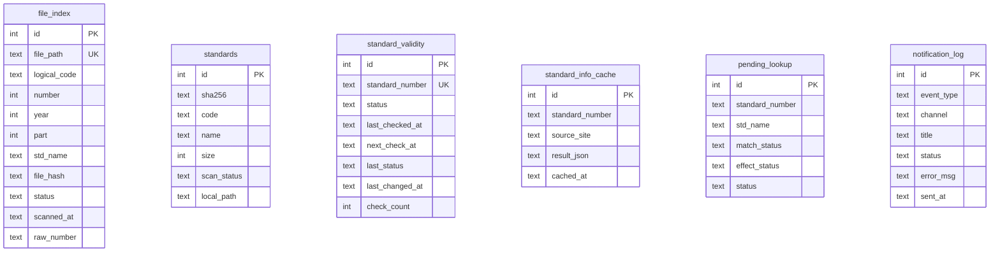

# 04 · 数据模型：三张核心表与辅助表

> 本文件回答：数据存在哪、谁写谁读、排查时查什么。  
> 先记三张核心表：`file_index`、`standards`、`standard_validity`。

---

## 一、数据地图



### 迁移链（2026-11-07 核实）

- 当前 schema：**v74**（`pilotstd/core/db/_constants.py`）；
- 迁移注册表：`MIGRATIONS: dict[int, Callable]`，启动时按版本执行；
- 迁移模块：**30 个 `_migrate*.py`**，覆盖 v2→v74（v1 是初始 schema；另有 `migrations.py` / `_migration_checksum.py` 两个基础设施文件）；
- 迁移源码受 P-106 约束：已执行迁移函数**不可改**，只能用新迁移修数据；
- 最近五项：
  - v70：`announcement_record.language`；
  - v71：`notification_log.user_id`；
  - v72：公告标准号归一化 + `standard_count` 重算；
  - v73：历史时间字符串统一为 ISO 8601 带时区偏移；
  - v74：修复 `standard_validity` 前导空格/缺代号畸形键。

**排查提示**：先看 `/api/health` 的 schema 版本；不要拿“本地迁移文件”推断线上已执行。迁移只在启动时跑，执行记录在 `_schema_version`。

---

## 二、三张核心表

### 1. `file_index`：文件在哪

**回答的问题**：某个文件路径属于哪个标准、状态是什么、哈希是多少。

主要字段（初始 schema + 后续迁移）：

| 字段 | 含义 |
|---|---|
| `id` | 主键 |
| `file_path` | 文件绝对路径，**唯一** |
| `logical_code` | 标准代号，如 `GB/T` |
| `number` | 顺序号（int） |
| `year` | 年份 |
| `part` | 部分号，`-1` 表示无 |
| `std_name` | 标准名称 |
| `file_hash` | 内容哈希（混合哈希，不是标准 SHA-256） |
| `status` | 文件状态（通常来自 `effect_status` 或“现行”） |
| `scanned_at` | 入库/扫描时间 |
| `raw_number` | 原始数字串（保留前导零） |
| `last_checked` | 路径有效性校验时间（后续迁移） |

**谁写**：

- 归档：`FileIndexRepository.upsert()`；
- 去重：`_dedup_standard()` 删除旧路径；
- 监控/索引：`FileWatchHandler`、`FileIndexRepository`；
- 启动校验：`validate_paths()` 删除不存在路径。

**谁读**：

- 归档去重：`find_by_standard()`；
- 状态统计：`/api/stats`、`StandardService`；
- 过期搬移：`ValidityChecker._move_expired_file()`；
- 收藏链：`_find_in_file_index()`。

**注意**：

- `file_index` 是“路径索引”，不是“内容身份表”；
- 同一标准可能有多条历史路径，去重依赖 `_dedup_standard()`；
- 当前 `FileScanner` 装配未注入 `file_index`，跨扫描哈希去重实际不生效。

---

### 2. `standards`：内容身份是什么

**回答的问题**：这份内容的四要素（sha256、code、name、size）是否已注册、是否已索引到本地路径。

字段（v42）：

| 字段 | 含义 |
|---|---|
| `sha256` | `hash_file_content()` 的混合哈希 |
| `code` | 标准代号 |
| `name` | 标准名称 |
| `size` | 文件大小 |
| `scan_status` | `pending` / `indexed` |
| `local_path` | 已索引时的本地路径 |
| `created_at/updated_at` | 时间 |

**唯一索引**：`(sha256, code, name, size)`。

**谁写**：

- 归档：`OrganizerCore._register_standard()`，`INSERT OR IGNORE`，初始 `pending`；
- 每日 `scan_and_index()`：四要素匹配后 `UPDATE scan_status='indexed', local_path=...`。

**谁读**：

- `scan_and_index()`；
- 内容去重/审计。

**注意**：

- `standards` 不负责“文件在哪里”的实时状态，实时路径在 `file_index`；
- `scan_and_index` 只 UPDATE，不 INSERT，也不移动文件。

---

### 3. `standard_validity`：历史有效性/待复检

**回答的问题**：这个标准上次什么时候检查、状态是什么、下次什么时候检查。

字段（v16 + 后续）：

| 字段 | 含义 |
|---|---|
| `standard_number` | 完整标准号，如 `GB/T 1234-2020`，**唯一** |
| `status` | 当前记录状态（现行/废止/未知/即将实施/被代替/作废/过期/待确认） |
| `last_checked_at` | 上次检查时间 |
| `next_check_at` | 下次检查时间 |
| `last_status` | 上次状态 |
| `last_status_updated_at` | 上次状态变更时间 |
| `last_changed_at` | 最近一次变化时间 |
| `check_count` | 检查次数 |

**谁写**：

- 归档：`register_new_standard()`，首次写入“未知”；
- 定时/手动时效检查：`update_status()`；
- 迁移：补列/回填。

**谁读**：

- `ValidityChecker`（选到期、L3 历史）；
- `/api/validity/history`；
- `/api/standards/status`（LEFT JOIN 取检查时间）；
- `/api/export/standards`；
- `/api/system/health`（COUNT）。

**注意**：

- 归档**不读**这张表；归档目录以 Query 的 `effect_status` 为准；
- 归档只写“未知”，不会把 Query 的废止状态写回；
- 历史上存在大量 `' <number>-<year>'` 畸形键（缺代号），见 [`08-known-boundaries.md`](08-known-boundaries.md)。

---

## 三、辅助表

| 表 | 用途 | 谁写 | 谁读 |
|---|---|---|---|
| `standard_info_cache` | 查询结果缓存（按 `standard_number + source_site`） | `CacheRepository.put()` | 查询引擎、`_backfill_std_name()` |
| `announcement_match` | 公告匹配缓存 | 公告流程 | `CacheRepository.get()` 回退 |
| `announcement_record` | 公告原始记录 | 公告流程 | 查询/分类器/有效性 |
| `pending_lookup` | 待确认清单 | `PendingService.record_pending()` | UI/API |
| `download_queue` | 等待公开期，不是执行队列 | `enqueue_download_wait()` | `get_due_downloads()` |
| `notification_log` | 通知发送记录 | `NotificationManager._log` | 通知日志 API/排障 |
| `pipeline_runs` | Web 五段式管道状态 | `pipeline_store` | Web 任务页 |
| `task_queue` | 通用任务表（UI 展示） | `TaskQueue.enqueue()` | 任务页 |
| `favorite_downloads` | 收藏下载状态机 | `download_to_inbox()` | 收藏链 cron |
| `daily_quota` | 适配器日配额 | `DailyQuotaTracker` | 查询路由 |
| `adapter_state` | 冷却/URL 状态 | `SiteRotator` | 查询路由 |
| `query_metrics` | 查询指标 | `QueryMetrics` | 排障/审计 |

---

## 四、状态字段与取值

`pilotstd/core/status.py` 是状态值的权威字典：

| 值 | 含义 |
|---|---|
| `现行` | 当前有效 |
| `即将实施` | 已发布未实施 |
| `废止` / `已废止` | 失效（别名归一） |
| `被代替` | 有替代标准 |
| `作废` | 作废 |
| `过期` | 过期 |
| `待确认` | 查询/匹配不确定 |
| `未知` | 尚未判定 |

**常用集合**：

- `ABOLISHED_STATUSES`：废止/已废止/作废/被代替；
- `ABOLISHED_STATUSES_WITH_EXPIRED`：再加“过期”；
- `EXPIRED_STATUSES`：废止/已废止/作废；
- `non-overridable`：含“待确认”。

**重要**：`过期作废` 是**目录名**，不是状态值。

---

## 五、常用排查 SQL

> 只读查询；生产环境不要直接 UPDATE。

### 1. 看文件是否入库

```sql
SELECT file_path, logical_code, number, year, status, scanned_at
FROM file_index
WHERE file_path LIKE '%GB_T 1234-2020%';
```

### 2. 看某标准的状态

```sql
SELECT standard_number, status, last_checked_at, next_check_at, check_count
FROM standard_validity
WHERE standard_number LIKE '%1234-2020%';
```

### 3. 看内容注册

```sql
SELECT sha256, code, name, size, scan_status, local_path
FROM standards
WHERE code = 'GB/T' AND name LIKE '%某某技术规范%';
```

### 4. 看通知是否发出

```sql
SELECT event_type, channel, title, status, error_msg, sent_at
FROM notification_log
ORDER BY sent_at DESC
LIMIT 20;
```

### 5. 看待确认

```sql
SELECT standard_number, std_name, match_status, effect_status, status
FROM pending_lookup
WHERE status = 'pending';
```

### 6. 看等待公开期

```sql
SELECT standard_number, standard_name, expected_available, status
FROM download_queue
WHERE status = 'waiting';
```

---

## 六、数据完整性坑

### 1. `file_index` 与 `standard_validity` 身份不一致

- `file_index` 用 `logical_code + number + year`；
- `standard_validity` 用完整 `standard_number` 字符串；
- 两者可能不一致（尤其畸形键），排查时不要只看一张表。

### 2. `standard_validity` 不自动同步 Query 状态

- 归档只写“未知”；
- Query 查到废止也不会写回；
- 定时检查才会更新；
- 所以“文件在过期作废”不代表“validity 表一定是废止”。

### 3. `standards` 与 `file_index` 职责不同

- `standards`：内容身份/扫描状态；
- `file_index`：文件路径/状态；
- 不要用 `standards` 查“当前文件在哪”。

### 4. 唯一键竞争

- `standard_validity.standard_number`、`file_index.file_path`、`standards` 四要素都有唯一约束；
- 业务层存在 `SELECT + INSERT` 非原子路径；
- 并发批量归档时可能看到 `UNIQUE constraint failed`。

### 5. 历史畸形键

- `standard_validity` 可能存在 `' 1234-2020'`（前导空格、缺代号）；
- 来源见 [`08-known-boundaries.md`](08-known-boundaries.md)；
- 不要让新逻辑默认“表里都是规范键”。

---

## 七、自检

1. 文件现在在哪，查哪张表？
2. 内容身份查哪张表？
3. 历史有效性/下次检查查哪张表？
4. 为什么文件已经归档，`standard_validity` 仍是“未知”？
5. `download_queue` 是下载执行队列吗？
6. `standards` 和 `file_index` 的区别是什么？
7. 看到 `UNIQUE constraint failed` 先想到哪两个原因？

参考答案见 [`10-assessment.md`](10-assessment.md)。
